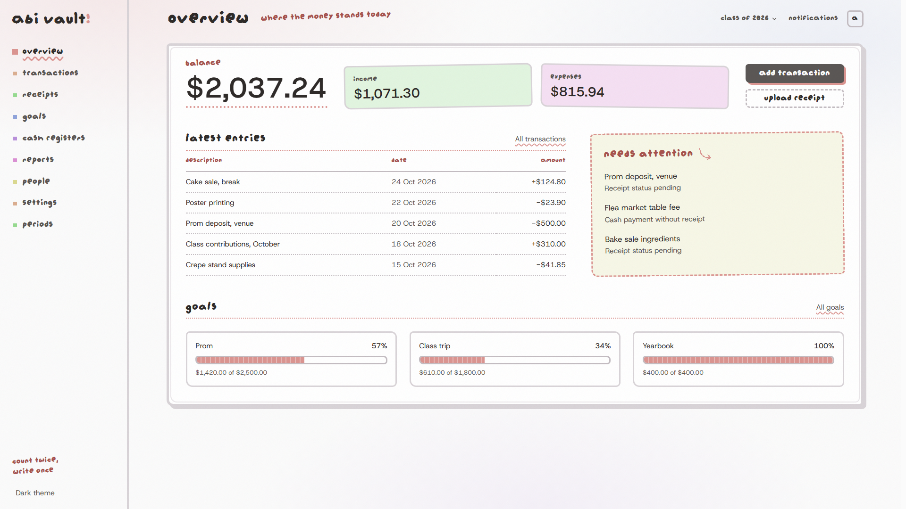
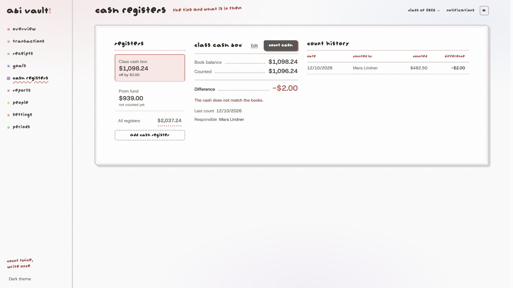
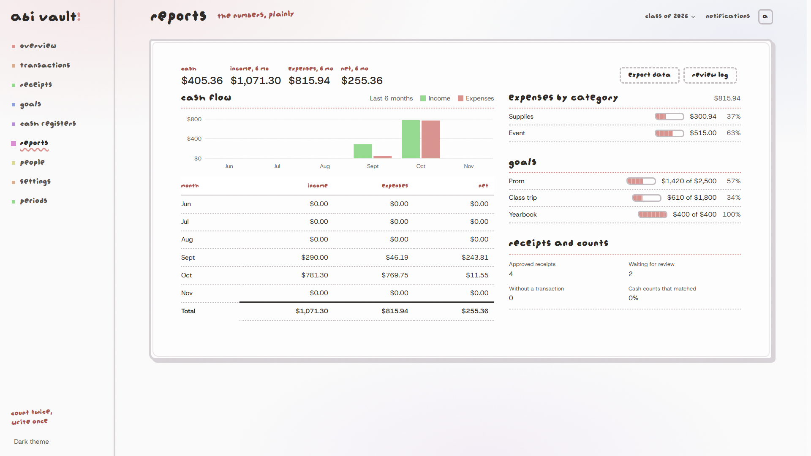

# Abi Vault

Abi Vault is an open-source finance workspace for school committees and small
teams. It keeps a class's money in one place: transactions, receipts, cash
registers, goals, reports, accounting periods, and who is responsible for what.

It is drawn like a pixel notebook, with handwriting-style headings, dotted
rules and a soft haze background. See [CREDITS.md](CREDITS.md) for where that
look comes from.



<details>
<summary>More screenshots (1920px)</summary>





</details>

## Features

- Income and expense transactions with categories, search and filters
- Receipt uploads with a review step (approve, reject, mark as pending)
- Cash registers with denomination counts and a book-versus-counted difference
- Fundraising goals with progress
- Reports, charts and CSV exports
- Member roles and invite links
- Admin-only accounting periods that lock the books
- Layouts for desktop, tablet and phone

## Quick start (sample data, no database)

The sample-data demo runs the whole interface without a database or sign-in.
You need Node.js 22+ and [pnpm](https://pnpm.io/).

```bash
pnpm install
cp .env.example .env.local
```

Set these values in `.env.local`:

```text
ABI_VAULT_LOCAL_MODE=true
NEXT_PUBLIC_ABI_VAULT_LOCAL_MODE=true
ABI_VAULT_DEMO_DATA=true
```

Then start it:

```bash
pnpm dev
```

Open <http://localhost:3000>. Two sample classes are included; switch between
them in the header. Changes you make (a transaction, a count, a goal) are kept
in memory and reset when the server restarts.

## Hosting

| You want to | Read |
| --- | --- |
| Put the sample-data demo online | [docs/vercel-demo.md](docs/vercel-demo.md) |
| Run it with Docker | [docs/self-hosting.md](docs/self-hosting.md#docker) |
| Run it against a local Supabase database | [docs/self-hosting.md](docs/self-hosting.md#local-supabase) |

## Project layout

- `app/dashboard/` holds the pages and their page-level state.
- `features/finance/actions/` holds finance reads and writes;
  `features/*/schemas/` validates input.
- `lib/finance/` holds money maths, projections and date keys.
- `lib/demo/` holds the sample data and the demo store.
- `components/ui/` holds shared controls; `components/dashboard/dialog.module.css`
  holds the shared dialog styles.
- `supabase/migrations/` defines the database schema and server functions.

[docs/backend-architecture.md](docs/backend-architecture.md) explains the data
flow, and [docs/design/DESIGN.md](docs/design/DESIGN.md) explains the look.

## Scope

Abi Vault is about manual class finance. Direct bank connections (Open
Banking) are deferred and not part of the current app.

## Contributing

Read [CONTRIBUTING.md](CONTRIBUTING.md) before opening a pull request. Report
security problems as described in [SECURITY.md](SECURITY.md).

## AI assistance

Parts of this project were written with the help of AI coding assistants
(Anthropic's Claude). That includes some backend code (finance queries, server
actions and database migrations), the interface redesign, tests and the
documentation. As with any codebase that handles money and permissions, read
the code before you trust it. The checks in [CONTRIBUTING.md](CONTRIBUTING.md)
(`pnpm lint`, `pnpm test:unit`, `pnpm build`) apply to all code, however it was
written.

## Credits

The visual style follows [ripple](https://github.com/0xQuerencia/ripple), which
is itself inspired by [Jame Gam](https://jamegam.hackclub.com/) from Hack Club.
Full attributions, including the pixel font and icons, are in
[CREDITS.md](CREDITS.md).

## License

Abi Vault is available under the [MIT License](LICENSE).
